<div align="center">

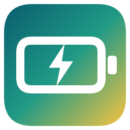

# PowerForge

### Battery health, power plans, keep-awake, and why your PC won't sleep.

A power and battery tool for Windows, written in **Rust**.
PowerForge shows how much charge your battery still holds, switches power plans for you, keeps the PC awake when you need it, and explains in plain words what stops the PC from sleeping and what woke it up.

<p>
  
  
  
  
</p>

<p>
  
  
  
  
  
  
</p>

[**Features**](#-features) ·
[**Screenshots**](#%EF%B8%8F-screenshots) ·
[**Download**](#-download) ·
[**Command line**](#%EF%B8%8F-command-line) ·
[**Build**](#%EF%B8%8F-build-from-source) ·
[**Developer**](#-developer)

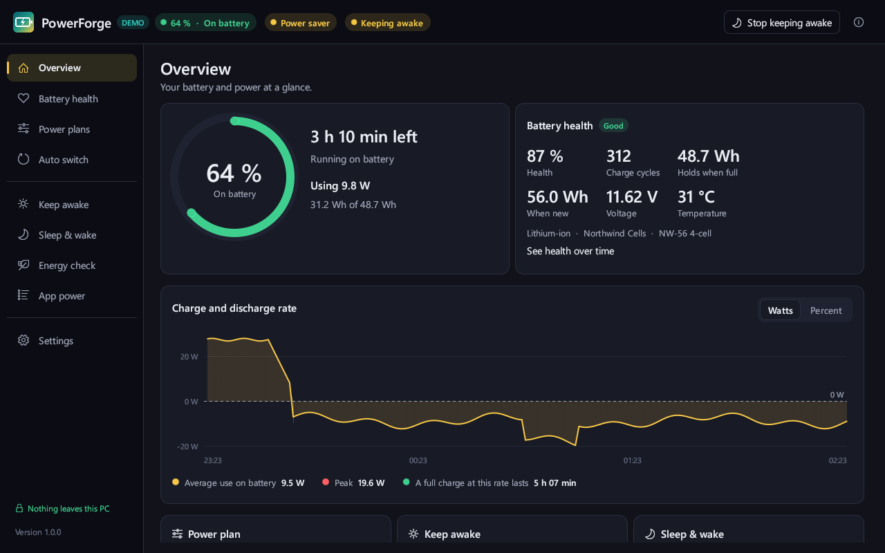

</div>

---

> [!NOTE]
> **First release.** On the developer's laptop PowerForge has been run for real: live battery readings, the Windows battery report, the power plan list, the last wake source, wake-capable devices, sleep states and the sleep/wake history from the event log. Everything that **changes** something (switching, editing, duplicating or deleting plans, auto switching, turning a device's wake permission or hibernation on and off) and everything that needs **administrator rights** (what blocks sleep, wake timers, the energy check) has been tested against mock backends and captured sample output only, not on a real PC, so that the owner's settings were never touched. Please report anything that behaves differently on your machine.

## ✨ Features

<table>
<tr>
<td width="50%" valign="top">

### 🔋 Battery at a glance
- Charge, state and time to full or to empty
- Live graph of the charge or discharge rate in watts, and of the charge level
- Battery health: how much of its original capacity it still holds, with a plain verdict
- Cycle count, chemistry, manufacturer, voltage and temperature
- Desktops without a battery get everything else

</td>
<td width="50%" valign="top">

### 📈 Health over time
- A daily capacity record kept on your PC, merged with the history Windows keeps in its battery report
- Wear per year and per 100 cycles, and when it will reach 80 %
- Runtime on a full charge: Windows' estimate, your own use, and when new
- Time on battery, plugged in and asleep over the last week
- Reminders: low battery, unplug at 80 %, plug in at 20 %, fully charged

</td>
</tr>
<tr>
<td valign="top">

### ⚙️ Power plans, in plain words
- Switch, duplicate, rename, delete and restore defaults
- Screen off, sleep and hibernate times, lid and power button, processor limits, wake timers and USB power saving, plugged in and on battery
- **Auto switch**: by power source, by a running app or by the app in front, and back to your own plan afterwards
- Tray menu to change the plan in two clicks

</td>
<td valign="top">

### ☀️ Keep awake
- One click, for a while, or until a set time
- While an app runs, or while a download or file copy is busy (network or disk above a threshold)
- Keep the screen on or let it turn off
- Tray menu and a global hotkey (Ctrl+Alt+K by default)
- Nothing in your power plan is changed; it ends when you stop it or PowerForge exits

</td>
</tr>
<tr>
<td valign="top">

### 🌙 Sleep and wake, explained
- What keeps the PC awake right now (browser video, audio, updates, remote sessions...) and what to do about it
- What woke it up last time, and scheduled wake timers
- Devices allowed to wake the PC, with a switch for each
- How this PC sleeps (Modern Standby or classic sleep), hibernation and its file size, fast startup
- Battery use while asleep, and a 14-day sleep and wake history from the event log

</td>
<td valign="top">

### 🍃 Energy check and app power
- Runs the Windows energy trace for 30 to 120 seconds with a progress bar and lists the findings in plain language, with what to do
- Estimated power per app from processor, graphics and disk use, clearly marked as an estimate
- HTML report and CSV exports
- Tray icon with the charge on it, start with Windows, dark and light themes
- Administrator rights are asked for only when you start an action that needs them

</td>
</tr>
</table>

## 🖼️ Screenshots

<table>
<tr>
<td width="50%" align="center"><b>Battery health</b><br>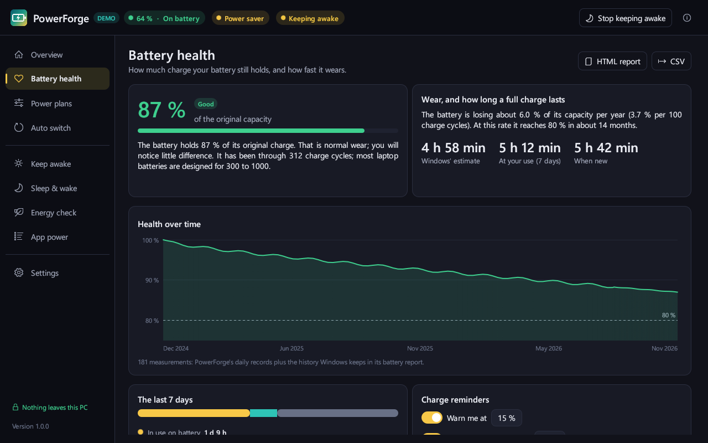</td>
<td width="50%" align="center"><b>Power plans</b><br>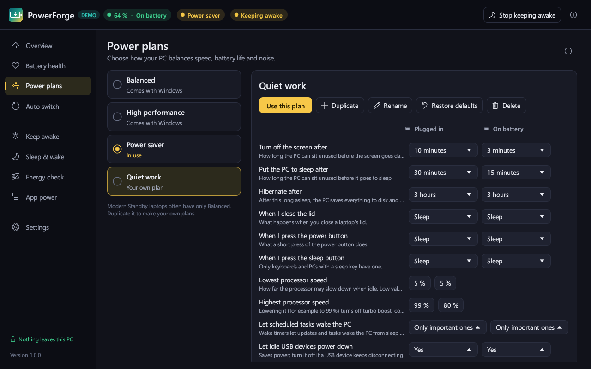</td>
</tr>
<tr>
<td width="50%" align="center"><b>Auto switch</b><br>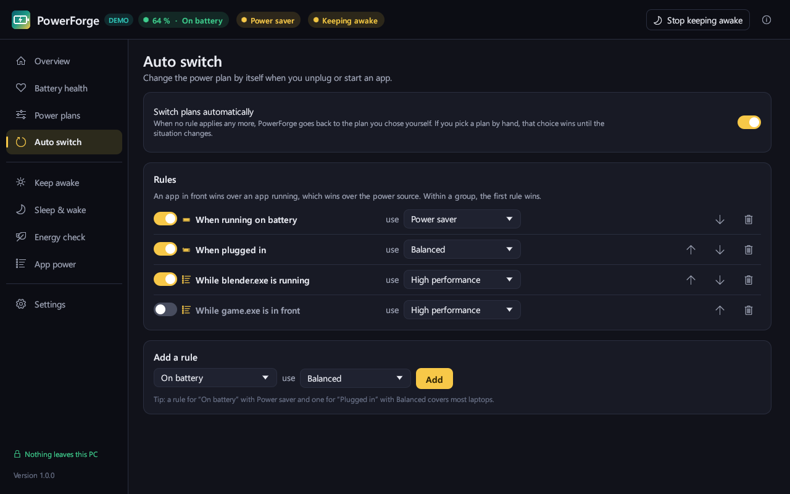</td>
<td width="50%" align="center"><b>Keep awake</b><br>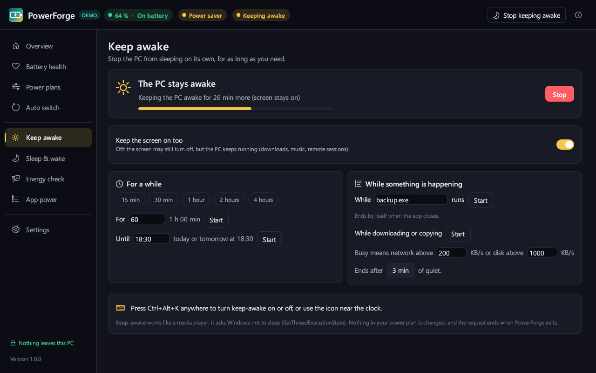</td>
</tr>
<tr>
<td width="50%" align="center"><b>Sleep and wake</b><br>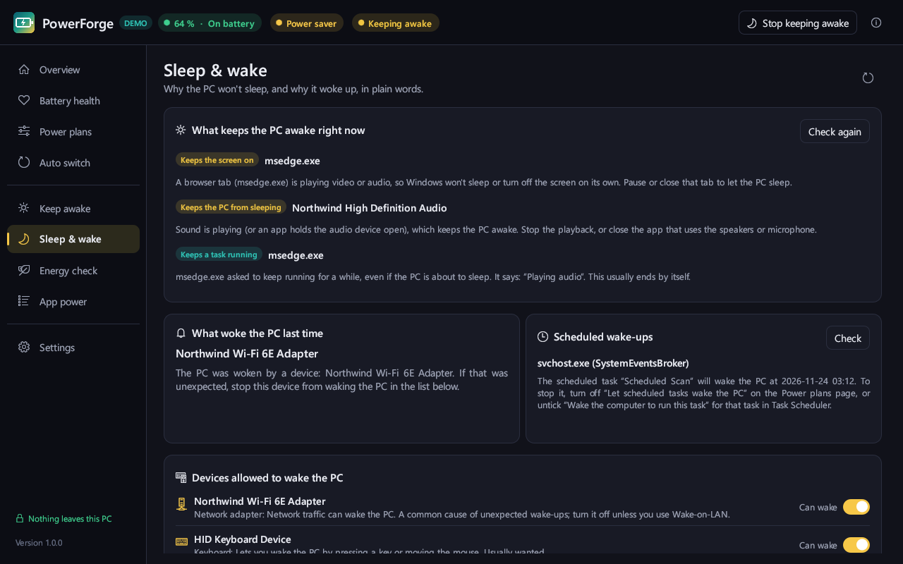</td>
<td width="50%" align="center"><b>Energy check</b><br>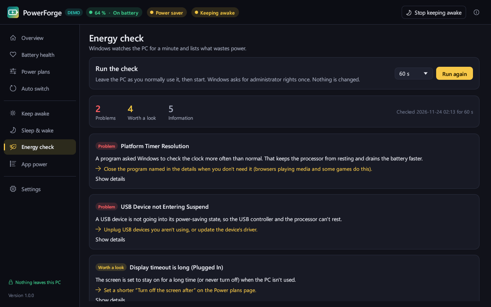</td>
</tr>
<tr>
<td width="50%" align="center"><b>App power</b><br>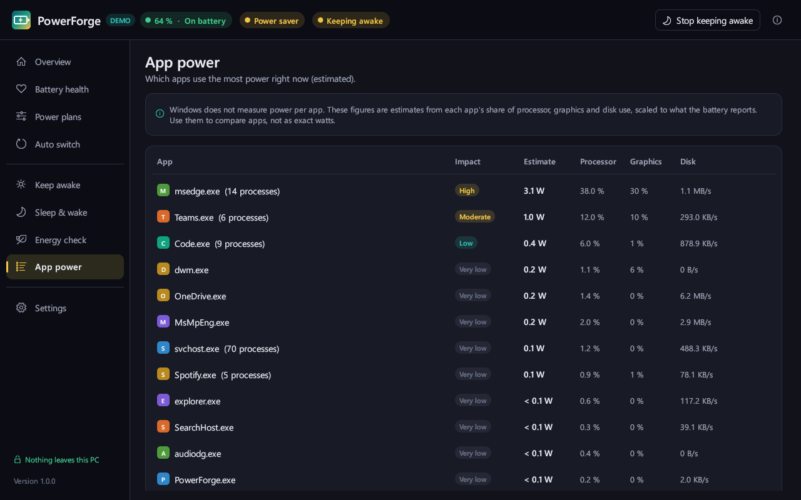</td>
<td width="50%" align="center"><b>Settings</b><br>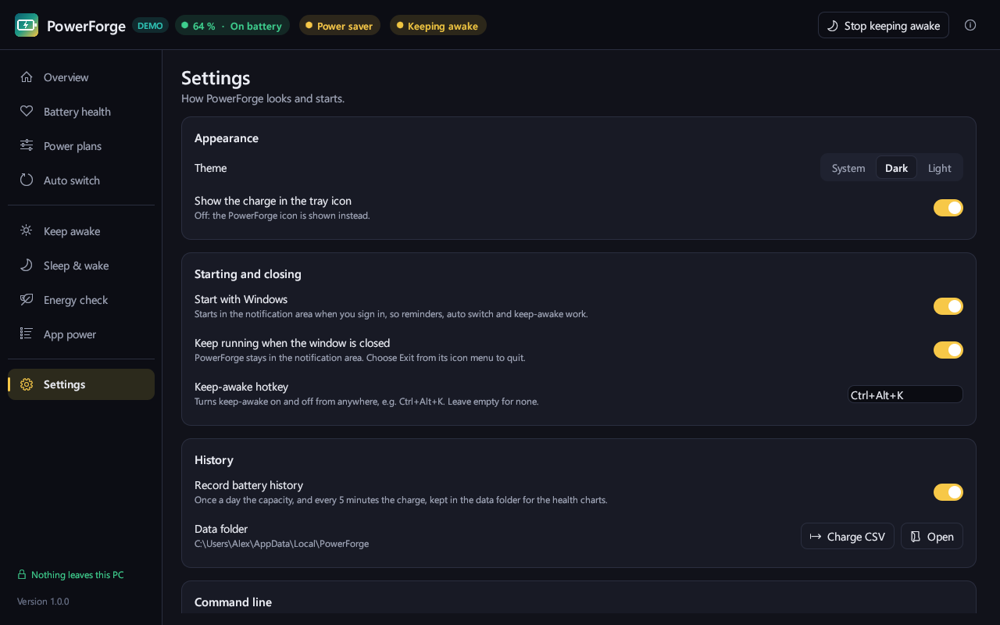</td>
</tr>
<tr>
<td colspan="2" align="center"><b>Light theme</b><br>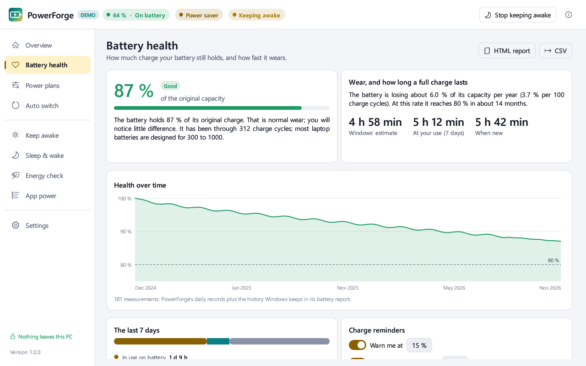</td>
</tr>
</table>

<sub>Screenshots use the built-in demo mode (<code>PowerForge.exe --demo</code>) with an invented laptop.</sub>

## 📥 Download

Get it from the [**latest release**](https://github.com/zheerkhalid/powerforge/releases/latest):

| File | What it is |
|---|---|
| `PowerForge-Setup.exe` | Installer with shortcuts, an optional start-with-Windows entry and an uninstaller (no administrator rights needed) |
| `PowerForge-x.y.z-portable-x64.zip` | Portable: unzip and run |
| `PowerForge.exe` | The bare 4.8 MB EXE |

PowerForge runs with your normal rights. These actions ask Windows for administrator rights, one prompt each, only when you start them: checking what blocks sleep, listing wake timers, changing which devices may wake the PC, turning hibernation on or off, and the energy check.

Good to know:

- PowerForge reads the English output of `powercfg` for what blocks sleep, the last wake source and wake timers. On Windows in other languages those three may show less detail; battery, plans and everything else use Windows APIs and work in any language.
- Per-app power is an estimate. Windows does not measure power per app.
- Battery health depends on what the battery reports. Some batteries report only a percentage, and then health can't be shown.
- Auto switch and reminders work while PowerForge runs (in the notification area). Turn on "Start with Windows" to have them always.

## ⌨️ Command line

| Command | What it does |
|---|---|
| `PowerForge.exe --awake 30m` | Keep the PC awake for 30 minutes (also `2h`, `1h30m`, `18:30`, `on`, `off`) |
| `PowerForge.exe --plan "Balanced"` | Switch to a power plan by name or GUID |
| `PowerForge.exe --plans` | List the power plans |
| `PowerForge.exe --report [--out file.html] [--csv file.csv]` | Write an HTML battery and power report |
| `PowerForge.exe --background` | Start in the notification area only |
| `PowerForge.exe --demo` | An invented laptop; nothing is read or changed |
| `PowerForge.exe --selftest` | Run the logic against mock backends and sample data |

## 🏗️ Build from source

Requires Rust (stable, MSVC toolchain) on Windows.

```powershell
git clone https://github.com/zheerkhalid/powerforge
cd powerforge
cargo build --release
# -> target\release\PowerForge.exe
cargo test
powershell -ExecutionPolicy Bypass -File scripts\package.ps1   # EXE, ZIP and (with Inno Setup 6) the installer
```

The icon is drawn in code at build time. The C runtime is linked statically, so the EXE runs on a clean Windows install. Tests never change the PC: power plans are tested against an in-memory fake and keep-awake against a recording stand-in.

## 👨‍💻 Developer

<table>
<tr>
<td align="center" width="140">
  <a href="https://zheer.dev">
    
  </a>
</td>
<td>

**Designed and developed by [Zheer Khalid](https://zheer.dev)**

🌐 Website: **[zheer.dev](https://zheer.dev)**  
🐙 GitHub: **[@zheerkhalid](https://github.com/zheerkhalid)**  
🧩 All the Forge apps in one place: **[ForgeDock](https://github.com/zheerkhalid/forgedock)**

If PowerForge is useful to you, a ⭐ on the repo is appreciated.

</td>
</tr>
</table>

## 📄 License

MIT © 2026 [Zheer Khalid](https://zheer.dev). See [`LICENSE`](LICENSE).

<div align="center">
<sub>Built with 🦀 Rust and ❤️ by <a href="https://zheer.dev">zheer.dev</a></sub>
</div>
